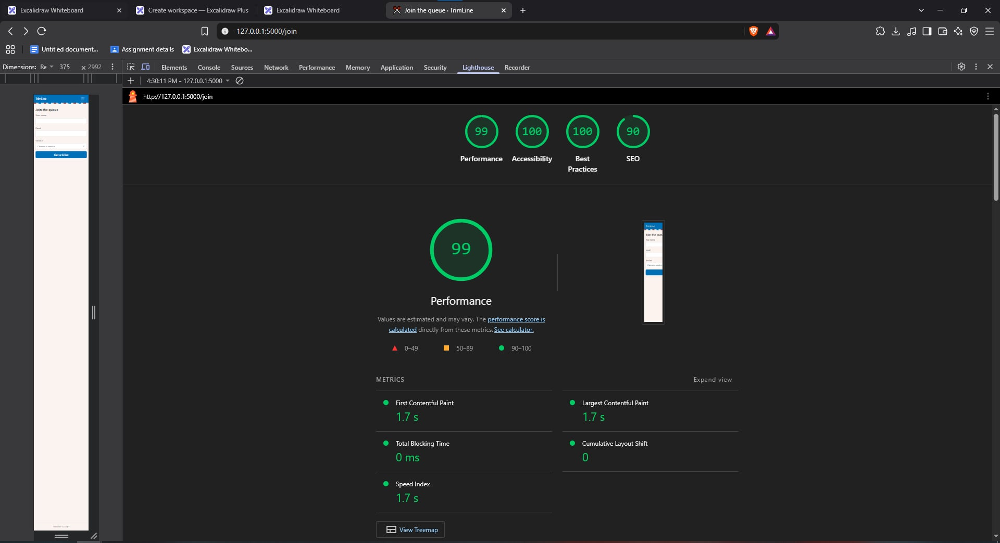
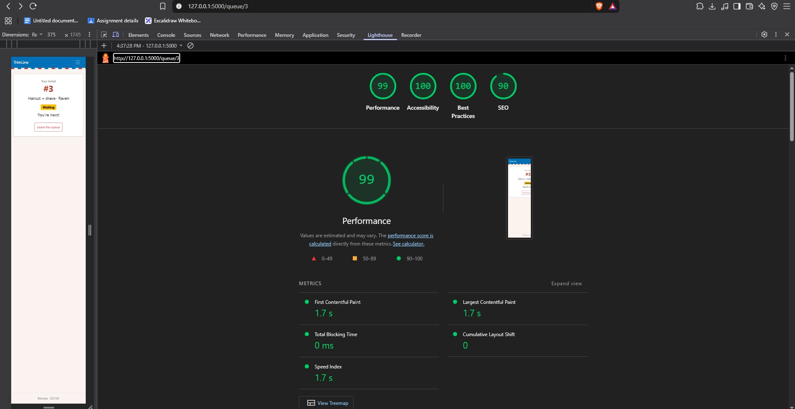
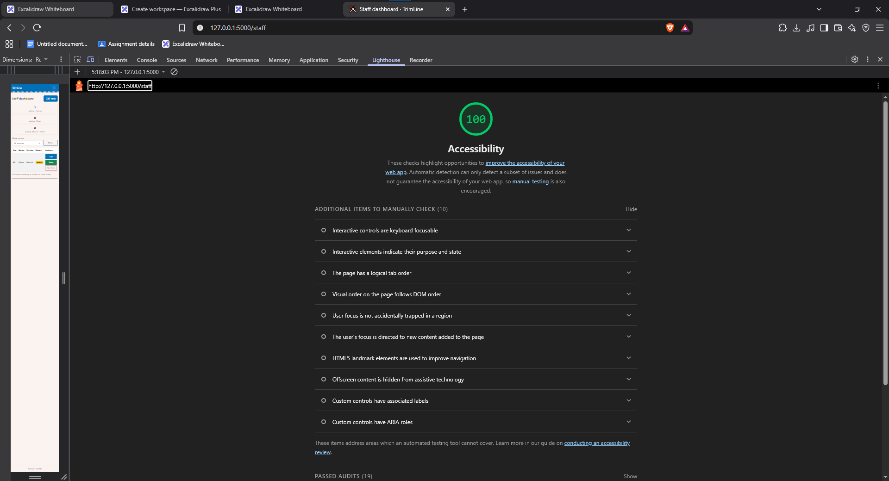

# Week 3 Accessibility Check: TrimLine

## 9a. Lighthouse (Accessibility, Mobile)

| Screen | Score | Screenshot |
| --- | --- | --- |
| Join | 100 |  |
| My place | 100 |  |
| Staff | 100 |  |

All three screens are above the 90 target.

Staff first scored 95. Lighthouse flagged low contrast on the Filter button (blue text on the cream background). I darkened the outline-button blue in `static/css/style.css` and re-ran it. Staff now scores 100.

## 9b. Keyboard-only test

Tested with Tab, Shift+Tab and Enter, with no mouse.

- **Join:** The skip link appeared on the first Tab. I reached Name, Email, Service and Get a ticket in order, and Enter submitted the form.
- **Staff:** I reached the service dropdown, Filter, Call next and a Serve button. Enter on Serve worked.
- **Problem found:** The focus outline on the navbar links was too faint against the blue navbar. On "Staff" it was easy to miss.
- **Fix:** I added `:focus-visible` rules in `static/css/style.css`. The navbar links now get a 3px white outline, and page controls get a 3px dark outline. I re-tested and the focus is clearly visible.
- **Problem found (manual check):** My place had no `<h1>`, so the heading check failed.
- **Fix:** I changed "Your ticket" from a `
` to an `<h1>` in `templates/ticket.html`, with `h6` and `fw-normal` so it looks the same. Each page now has exactly one `<h1>`.

## 9c. Manual checklist

| Check | Join | My place | Staff |
| --- | --- | --- | --- |
| Every input has a visible label | ✅ | n/a | ✅ (Show service) |
| Error messages say what to do, in text | ✅ | n/a | n/a |
| Status is shown in words, not only color | n/a | ✅ (Waiting badge) | ✅ |
| Readable at 375 px, no sideways page scroll | ✅ | ✅ | ✅ |
| Buttons about 44 px tall on a phone | ✅ | ✅ | ✅ 40 px (min-height in style.css) |
| One `<h1>` and headings in order | ✅ | ✅ (fixed) | ✅ |
| `<html lang="en">` is set | ✅ | ✅ | ✅ |