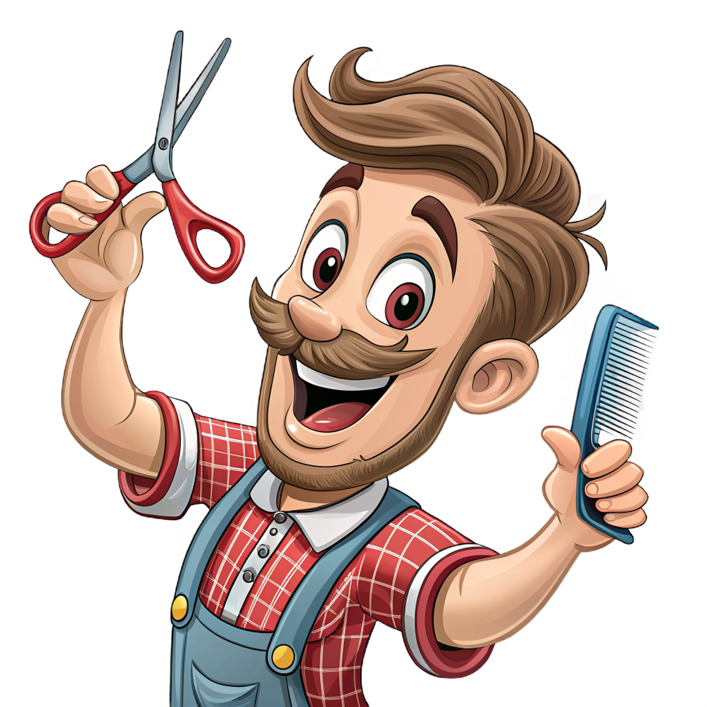

# TrimLine personas

## Migo, the person waiting

> "Not knowing when your turn will come, you just sit there unaware of anything." (interview)

| | |
| --- | --- |
| **Photo or sketch** |  Illustrated icon, not a photo of the person interviewed. |
| **Age, role and background** | 22, a 4th-year BS Statistics student (interview). Lives in a boarding house (interview). Gets haircuts at a walk-in shop with several barbers (interview). |
| **Goals** | 1. Know where he is in the order (interview). 2. Know what he is waiting for (interview). 3. Keep his turn without having to sit and guard it. |
| **Frustrations** | 1. Sits on the couch not knowing when his turn is (interview). 2. Won't leave, because someone else will take his spot and be cut before him (interview). |
| **Devices and context** | Infinix phone, in the barbershop waiting area (interview). Boarding-house wifi, no mobile data all the time (interview). |
| **Tech comfort** | High. He has used computers since high school and is highly literate with them (interview). |
| **Accessibility needs** | Often no data, so the page must be light and tolerate a lost connection (interview). |

### Scenario

Migo walks into the barbershop and sits on the couch. He knows nothing about when he will be called, and he won't step out because someone else would take his place. He opens TrimLine on his Infinix, joins the queue and sees his number and how many people are ahead. For the first time he knows what he is waiting for. He can see his position change and stay calm until the barber calls him.

### Top tasks in the app

| Task | Screen | Requirement ID |
| --- | --- | --- |
| Join the queue | Join | FR-01 |
| See how many people are ahead | My place | FR-02 |
| Leave the queue if he changes his mind | My place | FR-03 |

### What this means for my interface

1. Because he said the worst part is not knowing his turn, his number and "people ahead" must be the biggest thing on My place (FR-02).
2. Because he has no mobile data all the time, pages must stay light with no large images, and a failed refresh must not show an error (FR-02).
3. Because he stays only to protect his spot, the ticket must make his place visible and trusted, so he doesn't have to guard it (FR-01, FR-02).

---

## Mang Rey, the barber

> "I pick the one who went in first since my memory is still good." (interview)

| | |
| --- | --- |
| **Photo or sketch** |  Illustrated icon, not a photo of the person interviewed. |
| **Age, role and background** | 30, a barber with 7 years of experience at a walk-in shop with 4 barbers (interview). |
| **Goals** | 1. See how many people want a haircut (interview). 2. Know who goes first (interview). 3. Manage his time (interview). |
| **Frustrations** | 1. He relies on memory to know who came first (interview). 2. When a customer steps out, he takes the one inside, so the returning customer waits again (interview). |
| **Devices and context** | Phone on the table or in his pocket while cutting (interview). Hands busy, attention on the customer. |
| **Tech comfort** | Medium. He knows gadgets decently, uses a smartphone daily, browses social media and pays online (interview). |
| **Accessibility needs** | Hands busy cutting, so he can't do fiddly taps (observation). Quick glances at a phone on a table (observation). |

### Scenario

Mang Rey is cutting a customer's hair with his phone on the table. Three more people are waiting, and he has to remember who walked in first. When he finishes, he glances at TrimLine and sees how many are waiting and who is first. He taps Call next, and that person's phone shows "Called". If the person doesn't show up, he marks No-show with one tap and moves on without losing track.

### Top tasks in the app

| Task | Screen | Requirement ID |
| --- | --- | --- |
| See the waiting list in order | Staff dashboard | FR-04 |
| Call the next person | Staff dashboard | FR-05 |
| Mark served or no-show | Staff dashboard | FR-06 |

### What this means for my interface

1. Because he wants to see the number waiting and who goes first, the dashboard must show a count and the first person at the top (FR-04).
2. Because his hands are busy and his phone sits on a table, Call next must be a large button he can hit at a glance (FR-05).
3. Because he decides next from memory today, the list must be strictly in joining order, so no memory is needed (FR-04, FR-05).