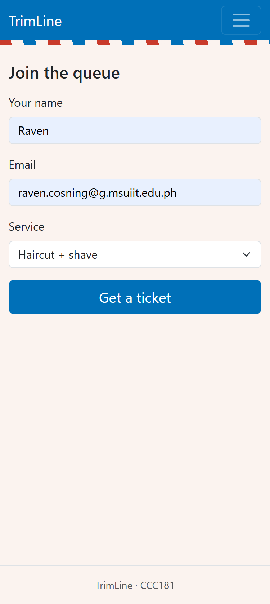
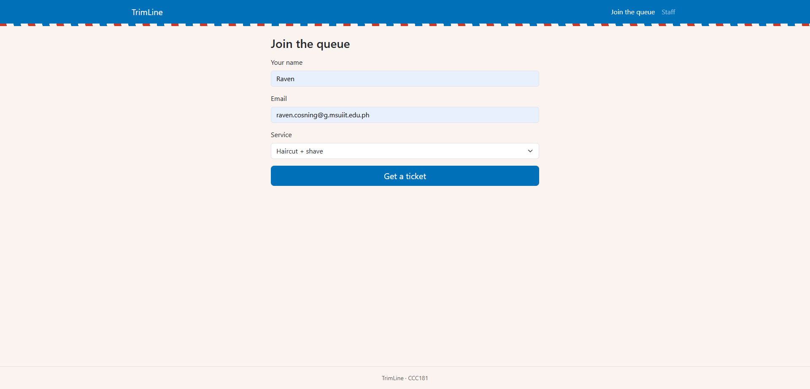
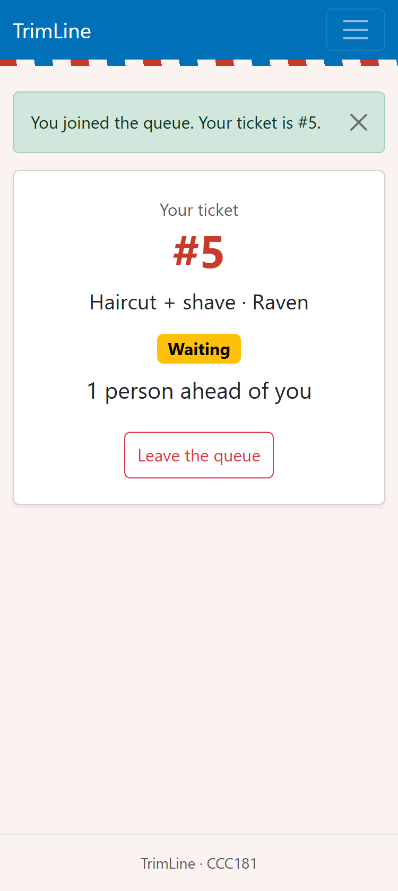
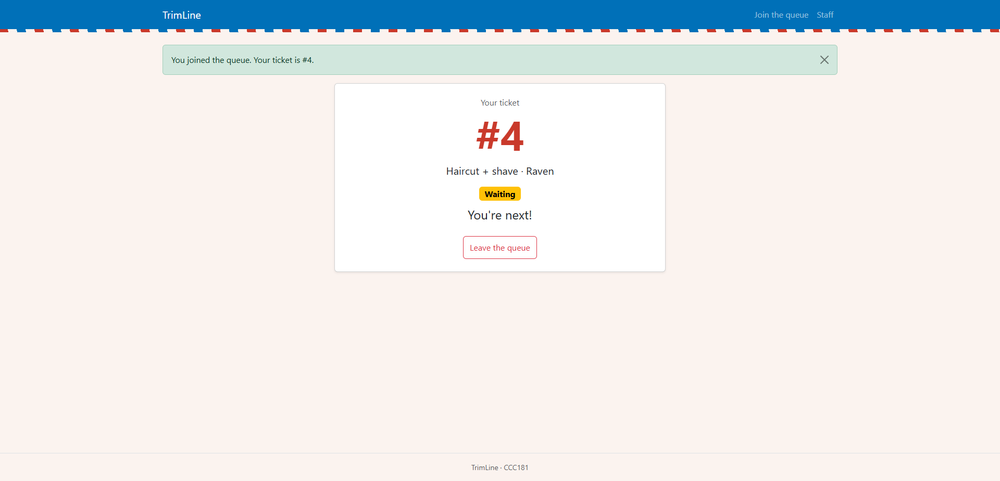
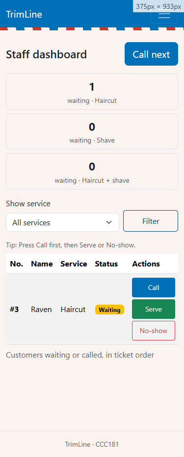
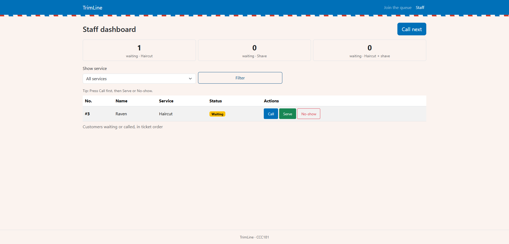
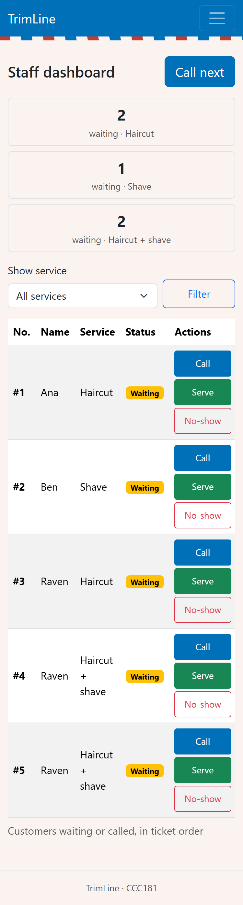

# Week 3 Report: TrimLine

## 1. Title details

- **App:** TrimLine
- **Setting:** A walk-in barbershop with four barbers
- **Name:** Raven Cosning
- **Student ID:** 2024-0598
- **Section:** CS3B
- **Date:** October 25, 2026
- **Pull request:** https://github.com/RavenCosning/CCC181/pull/1

## 2. Personas

Full personas are in [personas.md](personas.md).

- **Migo (person waiting):** "Not knowing when your turn will come, you just sit there unaware of anything." Top tasks: join the queue (FR-01), see how many people are ahead (FR-02), leave the queue (FR-03).
- **Mang Rey (barber):** "I pick the one who went in first since my memory is still good." Top tasks: see the waiting list in order (FR-04), call the next person (FR-05), mark served or no-show (FR-06).

## 3. Screens

| Screen | Phone | Laptop |
| --- | --- | --- |
| Join |  |  |
| My place |  |  |
| Staff |  |  |

- **Join:** used by Migo to get a ticket. Covers FR-01.
- **My place:** used by Migo to see his number, status and position, and to leave the queue. Covers FR-02, FR-03.
- **Staff dashboard:** used by Mang Rey to see the list, call the next person, and mark served or no-show. Covers FR-04, FR-05, FR-06.

## 4. Design decisions

1. **The ticket number and "people ahead" are the largest things on My place.** Migo said the worst part of waiting is not knowing his turn, so he must see his place at a glance.
2. **Pages are light, with no large images, and a failed refresh shows no error.** Migo often has no mobile data, so the page must tolerate a lost connection.
3. **Call next is a large button at the top right of the Staff dashboard, and the queue is in joining order.** Mang Rey's hands are busy and he currently relies on memory, so the first person must be obvious and the main action easy to hit.

## 5. Self-review

From [feedback.md](feedback.md): Join gives no wait-time estimate, My place refreshes only every 10 seconds, and the Staff buttons sit close together. I kept the layouts for Week 3 and listed a change for a later week for each.

## 6. Accessibility

Lighthouse Accessibility scores: Join 100, My place 100, Staff 100 (see [accessibility.md](accessibility.md)).

The most important issue I fixed: My place had no `<h1>`, so I changed "Your ticket" into one without changing how it looks. I also made the keyboard focus outline clearer on the navbar, and darkened the Filter button blue, which raised Staff from 95 to 100.

## 7. Usability test

A student customer matching Migo's persona tested the app on their own phone.

| Task | Result |
| --- | --- |
| 1. Join for a Haircut | Done, about 30 s |
| 2. Find number and people ahead | Done, about 10 s |
| 3. Call next and mark served | Done, about 15 s. They asked about the button order first. |

The tester's comment: "A good solution for an inconvenience."

**Improvement:** I added a tip line above the Staff table: "Tip: Press Call first, then Serve or No-show."

**Before:**

**After:**

Details are in [usability-test.md](usability-test.md).

## 8. Reflection

The hardest part was keeping the wireframes, screenshots and code consistent every time I changed a screen. In Week 4 the tickets move into PostgreSQL, so the ticket number, the people-ahead count and the waiting count per service will come from database queries instead of Python lists. I will need to keep the queue strictly in joining order, because Mang Rey's main rule is that he should not have to rely on memory.

## 9. Declaration

I used Claude (an AI assistant) to plan the work, review my wireframes and accessibility results, and draft the Markdown documents. I used two illustrated images from Pixabay for the personas, the Bootstrap 5.3.3 CDN, and my own color palette, inspired by classic barbershop red, blue and white stripes. The interviews, design choices, testing and final code are my own.