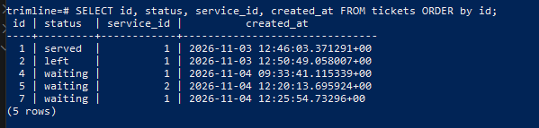
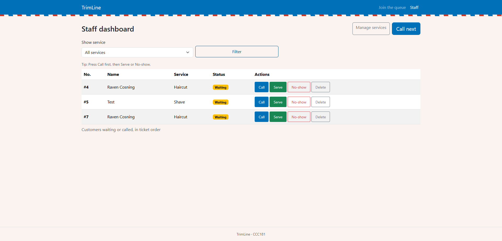
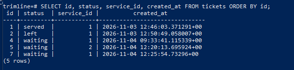

# TrimLine persistence proof

## Restart test

**Before restart:**

Ran `docker compose down` (removed the container and network, kept the volume), then `docker compose up -d`, waited for healthy, then restarted Flask.

**After restart:**

**Result: NFR-01 passes.** Every ticket, status and time matched exactly after the restart.

## Rebuild from scratch

(filled in below)