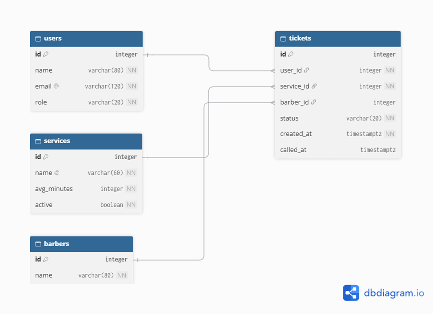
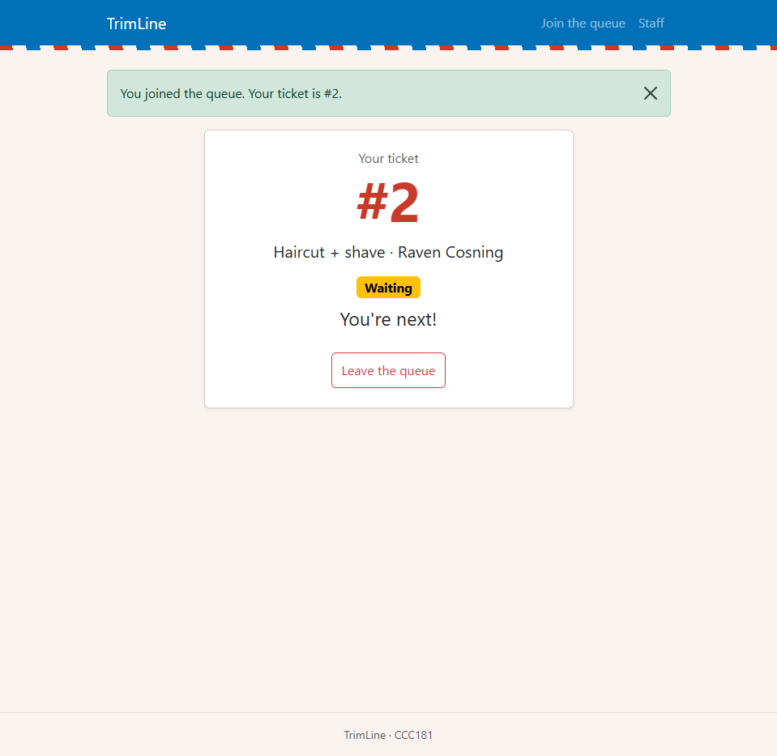
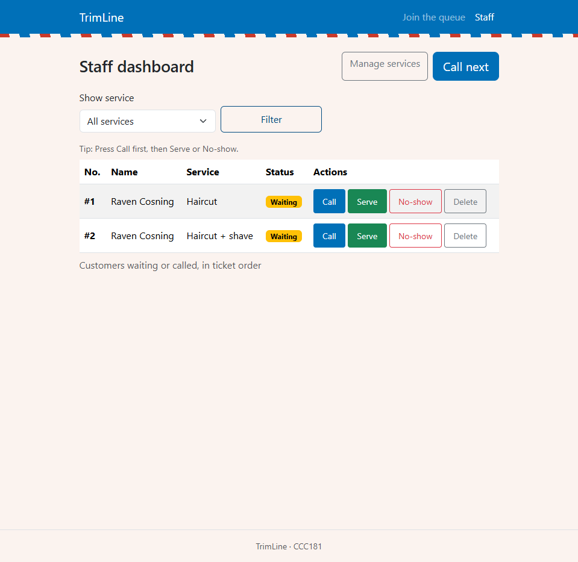
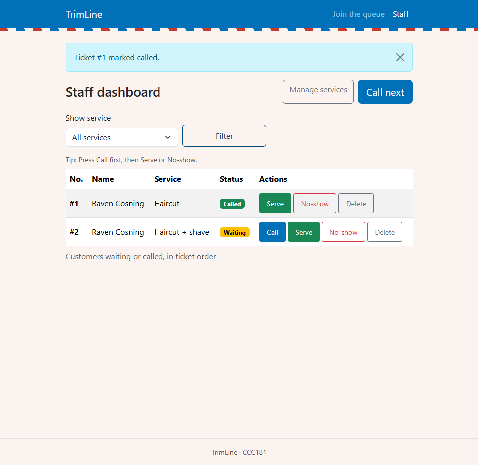
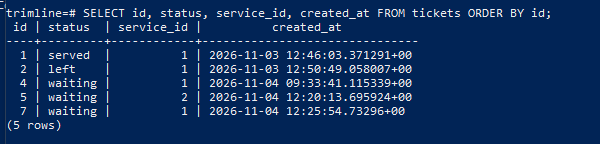
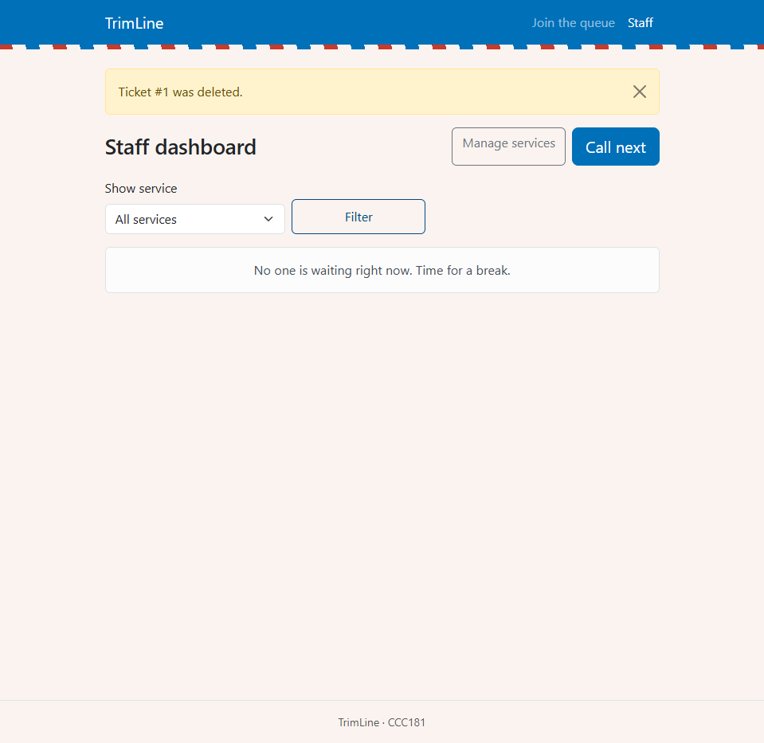
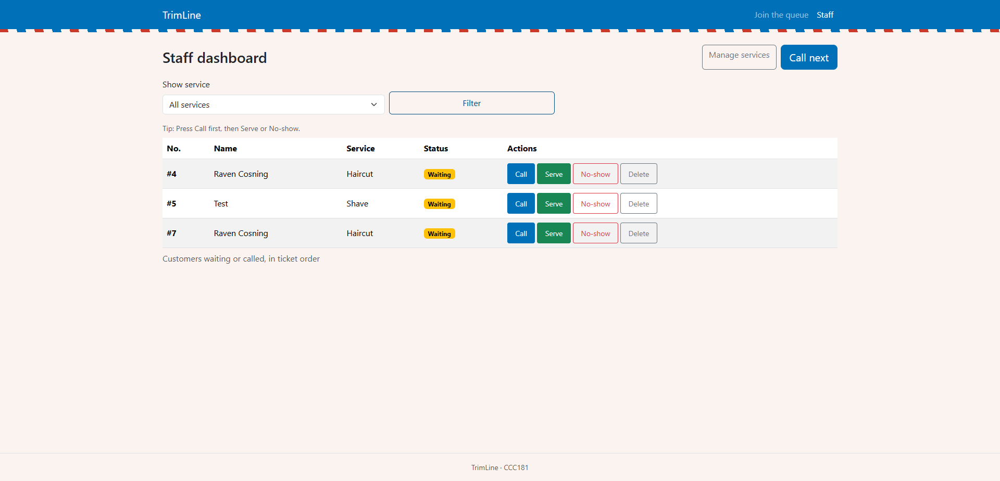
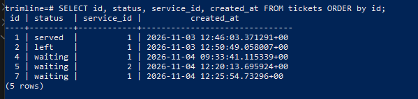

# Week 4 Report: TrimLine

## 1. Title details

- **App:** TrimLine
- **Setting:** A walk-in barbershop with four barbers
- **Name:** Raven Cosning
- **Student ID:** 2024-0598
- **Section:** CS3B
- **Date:** November 4, 2026
- **Database:** PostgreSQL 17 in Docker (no local PostgreSQL fallback used)
- **Pull request:** https://github.com/RavenCosning/CCC181/pull/2
## 2. Requirements

Full list: [requirements.md](../requirements.md).

- **Functional requirements:** 10 (FR-01 to FR-10), including 3 ★ requirements (FR-06 preferred barber, FR-08 no-shows per barber, FR-09 manage services).
- **Non-functional requirements:** 5 (NFR-01 to NFR-05): reliability, data integrity, performance, accessibility and security.
- **MVP:** FR-01 to FR-05, FR-09, and the Must-priority NFRs (NFR-01, NFR-02, NFR-04, NFR-05). This is the smallest version where a customer can join and wait, and a barber can run the shop, with data that survives a restart.
- **Out of scope:** FR-06 (preferred barber) and FR-10 (larger text size).
- **Feedback from a real person:** A customer asked, "If possible can I queue for my favorite barber? I want to choose which barber I want." I raised FR-06 from Should to Must. The same person said the most important thing is knowing their ticket number, which FR-02 already covers.

## 3. ERD



- One user has many tickets.
- One service has many tickets.
- One barber has many tickets, but a ticket's barber is optional.
- Each ticket belongs to exactly one user and one service, and optionally one barber.

Full design, types, constraints and delete rules: [schema.md](schema.md).

## 4. Schema

Output of `\d` for each table in psql:

```text
                                    Table "public.users"
 Column |          Type          | Collation | Nullable |              Default
--------+------------------------+-----------+----------+-----------------------------------
 id     | integer                |           | not null | nextval('users_id_seq'::regclass)
 name   | character varying(80)  |           | not null |
 email  | character varying(120) |           | not null |
 role   | character varying(20)  |           | not null | 'visitor'::character varying
Indexes:
    "users_pkey" PRIMARY KEY, btree (id)
    "users_email_key" UNIQUE CONSTRAINT, btree (email)
Check constraints:
    "ck_users_role" CHECK (role::text = ANY (ARRAY['visitor'::character varying, 'staff'::character varying]::text[]))
Referenced by:
    TABLE "tickets" CONSTRAINT "tickets_user_id_fkey" FOREIGN KEY (user_id) REFERENCES users(id) ON DELETE RESTRICT

                                      Table "public.services"
   Column    |         Type          | Collation | Nullable |               Default
-------------+-----------------------+-----------+----------+--------------------------------------
 id          | integer               |           | not null | nextval('services_id_seq'::regclass)
 name        | character varying(60) |           | not null |
 avg_minutes | integer               |           | not null |
 active      | boolean               |           | not null | true
Indexes:
    "services_pkey" PRIMARY KEY, btree (id)
    "services_name_key" UNIQUE CONSTRAINT, btree (name)
Check constraints:
    "ck_services_avg_minutes" CHECK (avg_minutes > 0)
Referenced by:
    TABLE "tickets" CONSTRAINT "tickets_service_id_fkey" FOREIGN KEY (service_id) REFERENCES services(id) ON DELETE RESTRICT

                                   Table "public.barbers"
 Column |         Type          | Collation | Nullable |               Default
--------+-----------------------+-----------+----------+-------------------------------------
 id     | integer               |           | not null | nextval('barbers_id_seq'::regclass)
 name   | character varying(80) |           | not null |
 active | boolean               |           | not null | true
Indexes:
    "barbers_pkey" PRIMARY KEY, btree (id)
Referenced by:
    TABLE "tickets" CONSTRAINT "tickets_barber_id_fkey" FOREIGN KEY (barber_id) REFERENCES barbers(id) ON DELETE SET NULL

                                       Table "public.tickets"
   Column   |           Type           | Collation | Nullable |               Default
------------+--------------------------+-----------+----------+-------------------------------------
 id         | integer                  |           | not null | nextval('tickets_id_seq'::regclass)
 status     | character varying(20)    |           | not null | 'waiting'::character varying
 created_at | timestamp with time zone |           | not null | now()
 called_at  | timestamp with time zone |           |          |
 user_id    | integer                  |           | not null |
 service_id | integer                  |           | not null |
 barber_id  | integer                  |           |          |
Indexes:
    "tickets_pkey" PRIMARY KEY, btree (id)
Check constraints:
    "ck_tickets_status" CHECK (status::text = ANY (ARRAY['waiting'::character varying, 'called'::character varying, 'served'::character varying, 'no-show'::character varying, 'left'::character varying]::text[]))
Foreign-key constraints:
    "tickets_barber_id_fkey" FOREIGN KEY (barber_id) REFERENCES barbers(id) ON DELETE SET NULL
    "tickets_service_id_fkey" FOREIGN KEY (service_id) REFERENCES services(id) ON DELETE RESTRICT
    "tickets_user_id_fkey" FOREIGN KEY (user_id) REFERENCES users(id) ON DELETE RESTRICT
```

## 5. Design decisions

1. **The queue is not a table, and position in line is computed, not stored.** FR-02 needs "people ahead", but a stored position would have to be rewritten for many rows every time someone joins or leaves. I store only `tickets.created_at` and count the earlier waiting tickets for the same service in `people_ahead()`. Migo's main need is to see his place at a glance, and the number is always correct because it is never stored.
2. **Leaving the queue is a soft delete, but a mistaken ticket is a hard delete.** For FR-03, leaving sets `status = 'left'` and keeps the row, because Mang Rey needs the history for reports such as FR-08. A test or mistaken ticket really should disappear, so staff get a separate Delete button that asks for confirmation first.
3. **Services are switched off, not deleted, and `tickets.service_id` uses RESTRICT.** For FR-09, a shop stops offering a service but still needs its old tickets. `services.active` hides a service from the join form, and the database refuses to delete a service that has tickets. The delete rule is enforced in two places: Flask shows a clear message, and PostgreSQL blocks it even if Flask has a bug.

## 6. Self-review

From [schema-review.md](schema-review.md):

- **Works well:** `tickets.service_id` with `RESTRICT` protects the shop's history, so a service with past tickets can never be deleted by accident. This matters for the no-show reports in FR-08.
- **Problem:** Nothing in the database stops a customer from having two `waiting` tickets for the same service, for example from a double form submit. **Change:** I kept the schema as is, because a database constraint would also block a customer from queuing for two different services, which is allowed. This is handled in Flask instead.
- **Problem:** `users.role` (visitor or staff) and the `barbers` table are unrelated, so a logged-in staff member is not linked to a barber a customer can request. **Change:** Kept and documented. Staff login is out of scope until Week 11, and `barbers` only drives the preferred-barber field.

## 7. Migrations

| Migration | What it does |
| --- | --- |
| `849fc0e0144c_initial_tables.py` | Creates the four tables `barbers`, `services`, `users` and `tickets` with all keys, UNIQUE and CHECK constraints and delete rules. |
| `41bf5d224b85_add_barbers_active.py` | Adds `barbers.active` (boolean, NOT NULL, default true) to the existing `barbers` table. |

## 8. CRUD

| Operation | Route | Requirement | Screenshot |
| --- | --- | --- | --- |
| Create | `POST /join` saves a new ticket | FR-01 |  |
| Read | `GET /staff` and `GET /queue/<id>` read tickets from PostgreSQL | FR-02, FR-04 |  |
| Update | `POST /staff/tickets/<id>/call` (also `serve`, `no-show`) changes the status | FR-04, FR-05 |  |
| Soft delete | `POST /queue/<id>/leave` sets the status to `left`, and the row stays | FR-03 |  |
| Hard delete | `POST /staff/tickets/<id>/delete` removes the row after confirmation | FR-04, FR-05 (cleanup of mistaken tickets) |  |

Services also have full CRUD at `/staff/services` (FR-09): create, edit with an Active checkbox, and delete, which is refused if the service has tickets. Every route that changes data is a POST.

## 9. Validation

Full table: [validation.md](validation.md). All three layers were tested:

- **Browser:** `required`, `type="email"` and `maxlength` on the join form. An empty name was blocked by the browser.
- **Flask:** curl requests that skip the form (empty name, bad email, service 999, an 85-character name) all returned 400 and saved nothing.
- **Database:** direct inserts and updates in psql were rejected by the foreign key, CHECK and UNIQUE constraints and by RESTRICT.

No SQL is built with f-strings, and the `git grep` check printed nothing.

**Most useful error:** `DELETE FROM services WHERE id = 1;` failed with `violates foreign key constraint "tickets_service_id_fkey" on table "tickets"`. It showed me that RESTRICT protects the shop's history even if my Flask code has a bug.

## 10. Persistence

Full details and screenshots: [persistence.md](persistence.md).

**Restart test:**






I stopped Flask, ran `docker compose down`, then `docker compose up -d`, waited for healthy and restarted Flask. All 5 tickets (IDs 1, 2, 4, 5 and 7) had the same statuses and times before and after.

**Rebuild from scratch:** `docker compose down -v`, `up -d`, `flask db upgrade` and `flask seed` rebuilt the whole database from the two migrations and the seed command. The join form listed Haircut, Haircut + shave and Shave, and I could join and reach My place. I did not use `db.create_all()`.

**NFR-01 (no ticket is lost when the server or database restarts): passed.**

## 11. Reflection

The hardest part was getting Docker and the database running reliably on Windows. At one point Docker and WSL crashed with a system resources error, and a restart of my PC fixed it. I also kept mixing up which terminal to type in: SQL belongs at the psql prompt, while `docker` and `flask` commands belong in PowerShell.

The requirement that was hardest to write in a testable way was FR-02, because "see how many people are ahead" had to become a rule I could check with a count in the database. NFR-03 (loads in under 2 seconds on mobile data) is also hard to test, and I have not measured it yet.

One known gap: `app.secret_key` is still a placeholder value in `app.py`. It moves into an environment variable in Week 11, together with staff login.

A report Mang Rey would want from this data is: how many customers were no-shows per barber today (FR-08). That needs a query over `tickets.status` and `tickets.created_at`, grouped by barber. I will write it in Week 5.

## 12. Declaration

I used Claude (an AI assistant) to plan the work, explain the Docker, PostgreSQL and SQLAlchemy steps, review my schema, and help draft the Markdown documents. The interviews, design choices, testing and final code are my own.