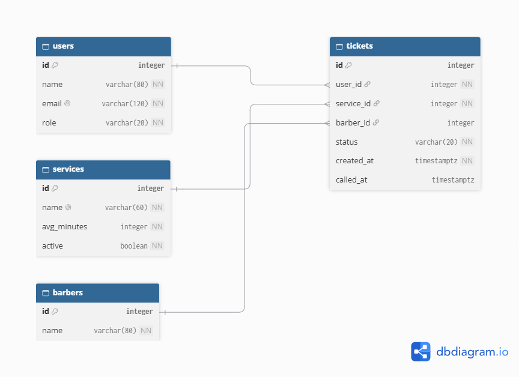

# TrimLine schema design

## 2a. Nouns

| Req ID | Requirement | Nouns | Table or column? |
| --- | --- | --- | --- |
| FR-01 | A customer can join the queue for a service by entering their name and email. | customer, queue, service, name, email | users, *(not a table — the queue is computed)*, services, users.name, users.email |
| FR-02 | A customer can see their ticket number, status, and how many people are ahead of them. | ticket number, status, ahead | tickets.id, tickets.status, *(computed, not stored)* |
| FR-03 | A customer can leave the queue before being called. | customer, queue | users, tickets.status (set to "left") |
| FR-04 | A barber can call the next waiting ticket for a service. | barber, ticket, service | users (role=staff), tickets, services |
| FR-05 | A barber can mark a called ticket as served or no-show. | barber, ticket, status | users, tickets.status |
| FR-06 ★ | A customer can request a specific barber when joining. | customer, barber, ticket | users, barbers (new table), tickets.barber_id |
| FR-08 ★ | A barber can see how many customers were no-shows today, per barber. | barber, no-shows, day | barbers, tickets.status, tickets.created_at (computed by date, not stored) |
| FR-09 ★ | A barber can add, rename, or switch off a service. | service, name, active | services.name, services.active |

## 2b. Tables and columns

| Table | Columns |
| --- | --- |
| `users` | id, name, email, role |
| `services` | id, name, avg_minutes, active |
| `barbers` | id, name |
| `tickets` | id, user_id, service_id, barber_id, status, created_at, called_at |

## 2c. Types and constraints

| Table | Column | PostgreSQL type | Constraint | Why |
| --- | --- | --- | --- | --- |
| users | id | integer, generated | PRIMARY KEY | Generated by the database, never reused |
| users | name | varchar(80) | NOT NULL | Required to join |
| users | email | varchar(120) | NOT NULL UNIQUE | One account per email |
| users | role | varchar(20) | NOT NULL DEFAULT 'visitor', CHECK (role IN ('visitor', 'staff')) | Only two kinds of users |
| services | id | integer, generated | PRIMARY KEY | |
| services | name | varchar(60) | NOT NULL UNIQUE | No two services share a name |
| services | avg_minutes | integer | NOT NULL, CHECK (avg_minutes > 0) | Rejects impossible values |
| services | active | boolean | NOT NULL DEFAULT true | Switched-off services stay in history |
| barbers | id | integer, generated | PRIMARY KEY | |
| barbers | name | varchar(80) | NOT NULL | |
| tickets | id | integer, generated | PRIMARY KEY | Ticket number shown to customers |
| tickets | user_id | integer | NOT NULL REFERENCES users(id) | Every ticket belongs to someone |
| tickets | service_id | integer | NOT NULL REFERENCES services(id) | No ticket for a missing service |
| tickets | barber_id | integer | REFERENCES barbers(id), nullable | Optional — not every customer picks a barber (FR-06) |
| tickets | status | varchar(20) | NOT NULL DEFAULT 'waiting', CHECK (status IN ('waiting','called','served','no-show','left')) | Only valid states |
| tickets | created_at | timestamptz | NOT NULL DEFAULT now() | Time zone safe; set by the database |
| tickets | called_at | timestamptz | nullable | Empty until the barber calls them |

## 2d. ERD

**Relationships:**
- One user has many tickets.
- One service has many tickets.
- One barber has many tickets, but a ticket's barber is optional.
- Each ticket belongs to exactly one user and one service, and optionally one barber.

**Delete rules:**

| Foreign key | Rule | Why |
| --- | --- | --- |
| tickets.user_id | RESTRICT | A customer's old tickets stay for history even if we ever delete users |
| tickets.service_id | RESTRICT | Deleting a service must not delete its past tickets — needed for reports (matches FR-09, Part 9c refuses delete if a service has tickets) |
| tickets.barber_id | SET NULL | If a barber leaves, their past tickets stay, just with no barber shown |

## 2e. Normalization check

1. **One value per cell (1NF):** No. No column holds a list — status, role, and names are all single values.
2. **Depends on the whole key (2NF):** N/A — no join (many-to-many) table exists yet. If barbers later need multiple services, this would need a check.
3. **No hidden copies (3NF):** No. A user's email and a service's name each live in exactly one row (users, services), and tickets only reference them by ID, never copy them.